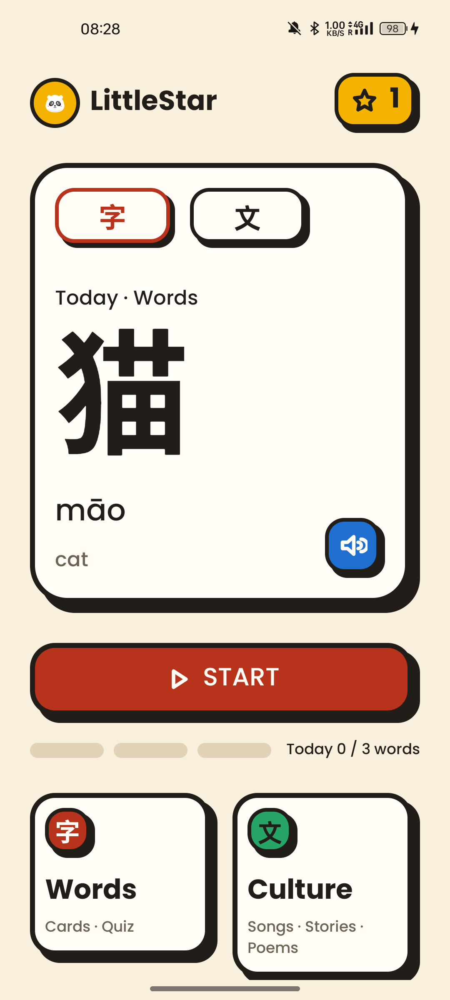
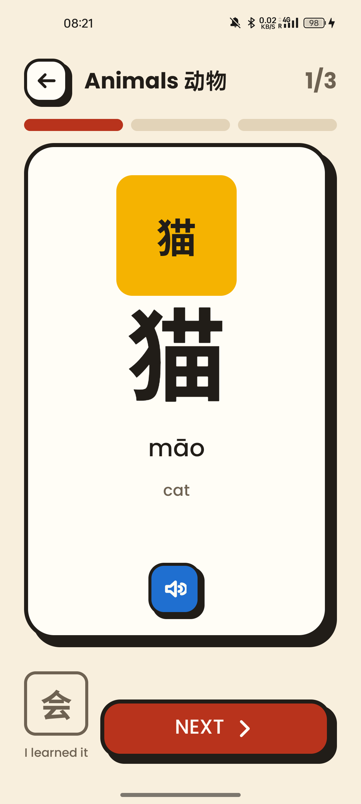
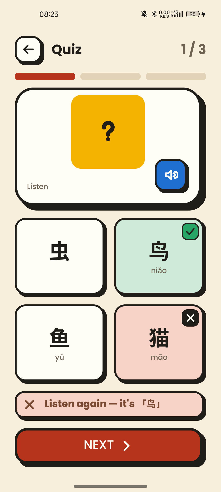
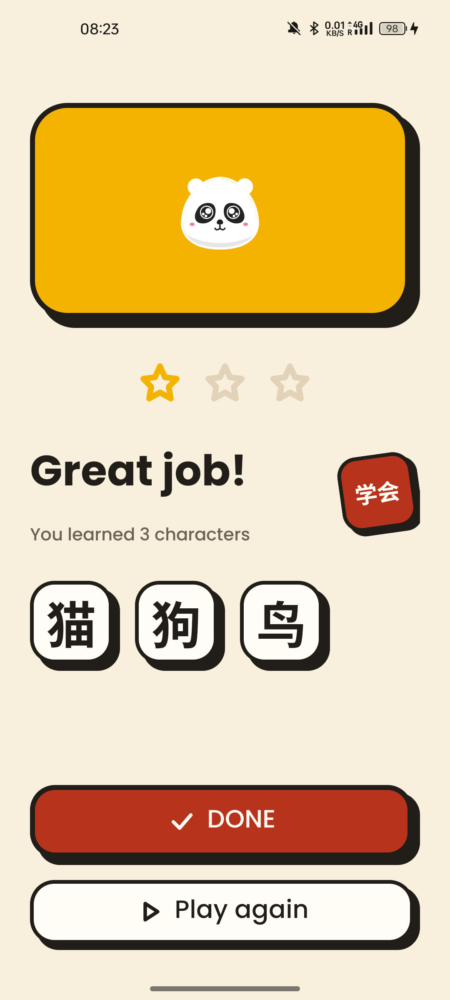
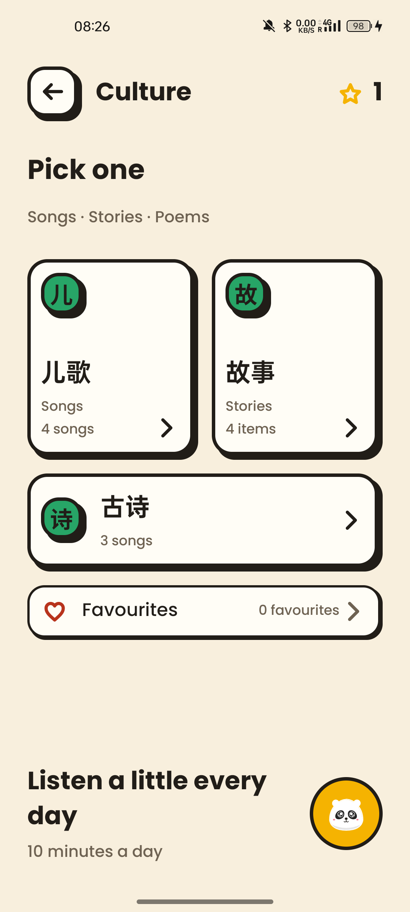
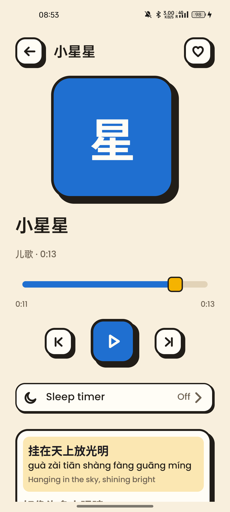
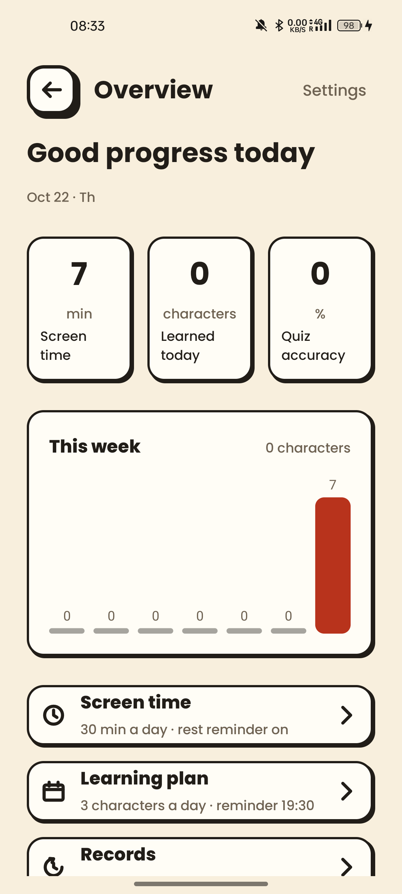
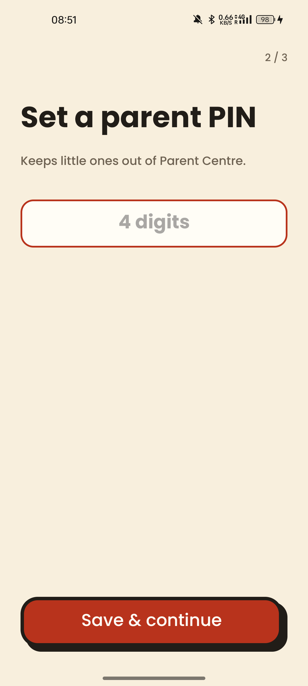
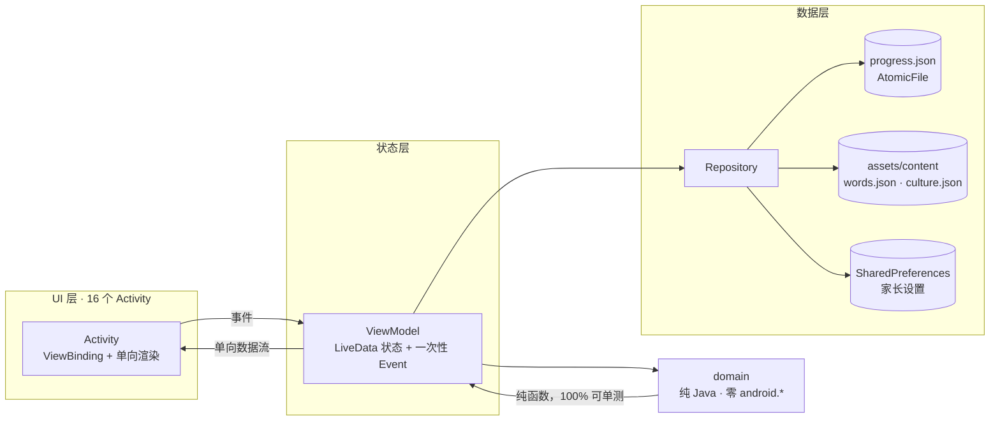

<div align="center">


# LittleStar · 汉字积木

**给海外华裔孩子的离线中文学习 App —— 每天 3 个字，一块一块拼起来。**

<p>
  
  
  
  
  
  
  
  <a href="https://github.com/Green-hats/LittleStar/releases/latest"></a>
  
  <a href="https://github.com/Green-hats/LittleStar/stargazers"></a>
</p>

<p>
  <a href="#它长什么样">截图</a> ·
  <a href="#功能">功能</a> ·
  <a href="#架构">架构</a> ·
  <a href="#快速开始">快速开始</a> ·
  <a href="LittleStar_设计书_v3.md">设计书</a> ·
  <a href="LittleStar_工程技术文档.md">工程文档</a> ·
  <a href="docs/DECISIONS.md">决策记录</a> ·
  <a href="docs/ACCEPTANCE.md">验收清单</a>
</p>


</div>

---

## 为什么做这个

乐乐四岁，住在墨尔本。家里说中文，幼儿园说英文。妈妈希望她上学前认识一些常用字，但不想她盯着屏幕超过二十分钟。

市面上的识字 App 大多是「游戏里塞几个字」：星星既是进度又是奖励，一次弹五个按钮，孩子点错就红屏。这个项目反过来做——**一屏只有一个主角、一个实心按钮**，答错不惩罚，学完就结束。

它也刻意做成了**英文外壳、中文内容**：孩子还不识字，靠图标、位置和声音操作；家长在英文环境里管理设置。汉字只出现在被学的地方。

> 完整的体验推导见 [设计书 v3](LittleStar_设计书_v3.md)，可施工的规格见 [工程技术文档](LittleStar_工程技术文档.md)。

## 它长什么样

<table>
  <tr>
    <td align="center"><br/><sub><b>首页</b> · 今天的一个字</sub></td>
    <td align="center"><br/><sub><b>识字卡</b> · 听、看、盖章</sub></td>
    <td align="center"><br/><sub><b>测验</b> · 看图选字，答错也不红</sub></td>
    <td align="center"><br/><sub><b>奖励</b> · 星星逐颗亮起</sub></td>
  </tr>
  <tr>
    <td align="center"><br/><sub><b>文化</b> · 儿歌 / 故事 / 古诗</sub></td>
    <td align="center"><br/><sub><b>家长锁</b> · PIN 验证</sub></td>
    <td align="center"><br/><sub><b>家长概览</b> · 只谈数据，不给星星</sub></td>
    <td align="center"><br/><sub><b>首次引导</b> · 三步调好</sub></td>
  </tr>
</table>

更多：每屏的浅色 / 深色变体在 [`docs/screenshots/`](docs/screenshots)（M1 组件库 → M8 走查）。

## 功能

| | 模块 | 内容 |
|---|---|---|
| 🀄 | **字** | 6 主题 × 6 字（动物 / 水果 / 颜色 / 数字 / 家人 / 自然）；识字卡 → 四选一测验 → 星星；Leitner 间隔复习自动安排复习字 |
| 🎵 | **文** | 儿歌 / 故事 / 古诗共 11 条；后台播放 + 锁屏控制、逐句歌词高亮、播完当前音轨再停的睡前定时 |
| 👨‍👩‍👧 | **家长** | PIN 锁；今日时长 / 学会字数 / 测验正确率 + 近 7 天柱状图；每日字数、提醒时间与星期；按天学习记录 |
| ⏳ | **节制** | 每日时长上限（到点进「今天看完啦」）、连续 15 分钟休息页、每日提醒通知、家长临时加 10 分钟 |
| ♿ | **细节** | 深色模式、1.3 倍字体不裁切、TalkBack 描述、进程被杀后回到同一题、无网络权限 |

## 架构



**几个刻意的技术选择：**

| 选择 | 原因 |
|---|---|
| **不用数据库** | 一年的学习数据只有几百 KB。整个文件启动读进内存，改完 `AtomicFile` 原子写回 + 2 秒防抖 + 每日备份 + 损坏回退；查询就是普通 Java 循环 |
| **磁盘单线程** | 所有读写投递到 `diskIO()` 一个线程，状态只在该线程读改，天然免锁——一个 `update()` 里的多步修改就是一次事务 |
| **硬影自己画** | `BlockLayout` 用 Canvas 画 4dp 墨线 + 6dp 硬影，按下时内容下沉、影子不动剩 2dp；`elevation` / `layer-list` 做不到「内容动、影子不动」 |
| **打包汉字子集字体** | 厂商中文字体字形不一。从 Noto Sans SC 子集出 195 字（43KB），保证「月」「骨」等字形与课本一致 |
| **无 INTERNET 权限** | 内容、音频全部内置；`aapt dump permissions` 是验收项，不是口号 |
| **英文外壳 + 中文内容** | 孩子不识字，界面靠图形与声音；汉字只出现在被学的位置（详见 [D30](docs/DECISIONS.md)） |

## 技术栈

| 层 | 选型 |
|---|---|
| 语言 / 构建 | Java 17、Groovy DSL、AGP + version catalog（**全工程零 Kotlin 源文件**） |
| UI | XML View + ViewBinding、Material 3（仅家长区） |
| 状态 | ViewModel + LiveData + `Event` 一次性事件、SavedStateHandle 进程恢复 |
| 音频 | Media3 ExoPlayer + MediaSessionService（长音频）、SoundPool（音效）、独立 ExoPlayer（字音） |
| 数据 | Gson + `AtomicFile`（progress.json）、SharedPreferences（设置），无 Room / 无注解处理器 |
| 时间 | `java.time` + 可注入 `AppClock`（业务逻辑全走它，方便测试） |
| 测试 | JUnit4 + `InstantTaskExecutorRule`、Espresso + ActivityScenario；domain 层纯 Java |
| 校验 | 自写 `contrast_check.py`（WCAG 对比度）、`validate_content.py`（内容 ↔ 资源对账） |

## 快速开始

**最快的方式**：直接从 [Releases](https://github.com/Green-hats/LittleStar/releases/latest) 下载 `LittleStar-0.1.0-preview.apk`（debug 签名预览包，Android 8.0+）。

```bash
# 从源码：需要 JDK 17+ 与 Android SDK（compileSdk 36，minSdk 26）
git clone https://github.com/Green-hats/LittleStar.git
cd LittleStar
echo "sdk.dir=$HOME/Library/Android/sdk" > local.properties   # 或写你自己的 SDK 路径

./gradlew assembleDebug                 # → app/build/outputs/apk/debug/
adb install -r app/build/outputs/apk/debug/app-debug.apk
```

**跑测试**

```bash
./gradlew testDebugUnitTest             # 43 个 JVM 单测（domain / 存储 / 内容）
./gradlew connectedDebugAndroidTest     # 4 个真机用例（全流程冒烟 / 休息页 ×2 / 原子写）
```

**工程自检**

```bash
python3 tools/contrast_check.py         # 浅色 + 深色全部 ≥ 4.5:1 才退出 0
python3 tools/validate_content.py       # 内容 ID 唯一，音频与图片一一对应
python3 tools/subset_font.py            # 重新生成汉字子集字体（需 fonttools）
bash    tools/make_placeholder_audio.sh # 开发期占位音频（macOS say）
```

## 项目结构

```
LittleStar/
├─ app/src/main/java/com/littlestar/app/
│  ├─ core/          # BlockLayout、6 个自定义 View、AppClock、音频、时长追踪
│  ├─ data/          # 内容、progress.json 存储、SharedPreferences、三个 Repository
│  ├─ domain/        # 复习调度、组卷、出题、星星、首页模式、时长策略（纯 Java）
│  ├─ feature/       # home · words · flashcard · quiz · reward · culture · player
│  │                 # favourites · sleep · parent · timeup
│  ├─ playback/      # MediaSessionService + 睡前定时
│  └─ notify/        # 通知渠道、每日提醒调度与广播
├─ assets/           # 设计图源文件（定稿视觉参照）
├─ docs/             # 验收清单、决策记录、逐里程碑截图
├─ tools/            # 校验脚本、字体子集、占位音频、截图走查
├─ LittleStar_设计书_v3.md
└─ LittleStar_工程技术文档.md
```

## 测试与验收

| 项 | 结果 |
|---|---|
| JVM 单测 | **43 / 43 通过**（复习调度、组卷、出题分布、星星、时长策略、存储防抖与损坏恢复、派生统计） |
| 真机用例 | **4 / 4 通过**（全流程 Espresso 冒烟、REST / LIMIT 两态、AtomicFile 读写） |
| 对比度 | 浅色 / 深色 **全部 ≥ 4.5:1** |
| release（R8） | APK **5.8 MB**，冷启动 **726 ms**，杀进程后学习进度保留 |
| 权限 | 无 `INTERNET`（`aapt dump permissions` 只有通知 / 前台服务 / 开机广播） |
| 真机 | 一加 8T（1080×2400@480dpi，Android 14）逐屏截图验收 |

明细与证据：[`docs/ACCEPTANCE.md`](docs/ACCEPTANCE.md) · 关键取舍：[`docs/DECISIONS.md`](docs/DECISIONS.md)（32 条）

## Roadmap

- [x] M0 骨架 · M1 组件库 · M2 数据层 · M3 核心学习流
- [x] M4 字模块 · M5 文化模块 · M6 家长区 · M7 时长与通知 · M8 打磨验收
- [x] 英文外壳 + 中文内容的文案改版
- [x] 家长验证改为 PIN（引导时设定）
- [ ] 定格插画替换占位色块（30 张词卡 + 11 张封面）
- [ ] 真人录音替换 TTS 占位音频
- [ ] 成语 / 节日两类文化扩到 MVP
- [ ] 1.3 倍字体与 360×640 小屏真机走查（当前受测试机 ROM 权限限制）
- [ ] 平板布局（480dp 内容上限已就位）

## 贡献

Issue 与 PR 都欢迎。改动前建议先读 [`docs/DECISIONS.md`](docs/DECISIONS.md)——里面记了每个「为什么不那样做」。文案不硬编码，颜色只在 `colors.xml`，尺寸只在 `dimens.xml`；`python3 tools/contrast_check.py` 与 `validate_content.py` 会替你把关。

## 许可与致谢

代码以 [MIT](LICENSE) 许可发布。字体 [Noto Sans SC](https://fonts.google.com/noto/specimen/Noto+Sans+SC)（SIL OFL 1.1，子集化）、[Poppins](https://fonts.google.com/specimen/Poppins)（SIL OFL 1.1）。儿歌与古诗文本为公版，故事为自行改写；占位音频由 macOS TTS 生成，仅供开发。

<div align="center"><sub>如果它让你想起某个正在学写字的小孩，⭐ 是一种鼓励</sub></div>
