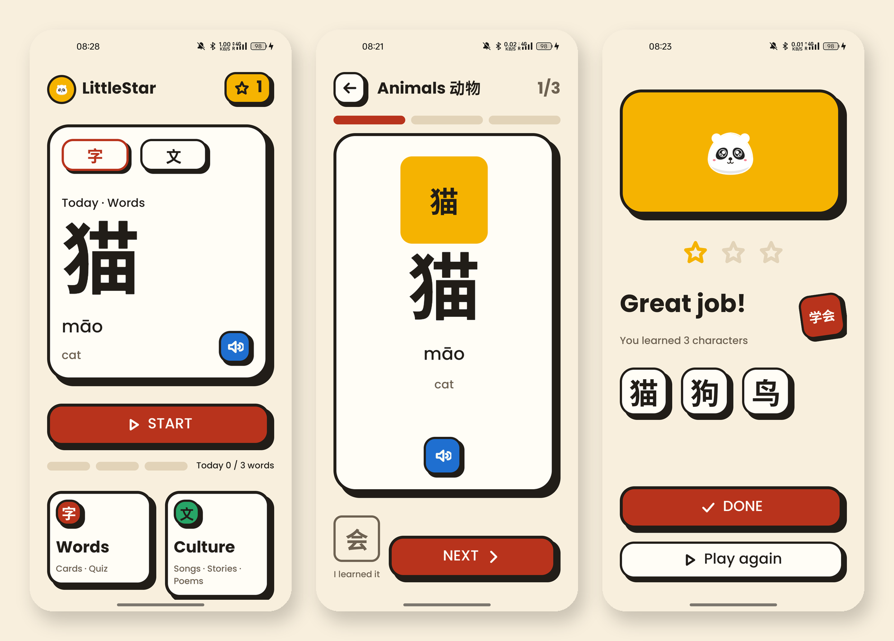
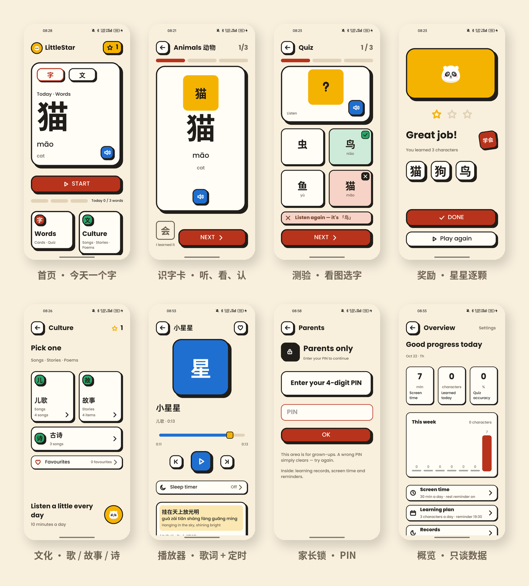

<div align="center">


# LittleStar · 汉字积木

**给海外华裔孩子的识字 App —— 每天 3 个字，一屏只做一件事。**

<p>
  <a href="https://github.com/Green-hats/LittleStar/releases/latest"></a>
  
  
  
  
  
  <a href="https://github.com/Green-hats/LittleStar/stargazers"></a>
</p>



</div>

## 它是什么

一个给三到六岁、在英语环境里长大的孩子学汉字的 Android App。

界面是英文的，学的内容是中文的——孩子还不识字，靠图标、位置和声音操作。每天 3 个新字 + 2 个复习字：学 3 分钟，测 2 分钟，奖励 1 分钟，然后结束。

## 五个刻意的选择

- **一屏一个实心按钮** —— 孩子不会点错，也不会有第二个「现在该做什么」
- **答错不惩罚** —— 陶土色 + 轻轻抖一下 + 直接告诉答案，没有红屏，不扣星
- **星星只做奖励** —— 进度用字块表示，家长区只谈数据
- **完全离线** —— 没有 `INTERNET` 权限，字库、录音、插画全部内置
- **到点就停** —— 每日时长上限、连续 15 分钟休息页、睡前「播完这首再停」



## 快速开始

```bash
# 直接把预览版装到手机（Android 8.0+）
open https://github.com/Green-hats/LittleStar/releases/latest

# 或者从源码构建（JDK 17+ / Android SDK 36）
git clone https://github.com/Green-hats/LittleStar.git && cd LittleStar
echo "sdk.dir=$HOME/Library/Android/sdk" > local.properties
./gradlew assembleDebug
adb install -r app/build/outputs/apk/debug/app-debug.apk
```

## 技术

**Java 17** · XML View + ViewBinding · MVVM + LiveData · Media3 ExoPlayer · Gson + AtomicFile
零 Kotlin · 无数据库 · 无注解处理器 · 43 个 JVM 单测 + 4 个真机用例

<details>
<summary><b>几个实现细节（点开）</b></summary>

- **不用数据库**：一年数据只有几百 KB。`progress.json` 原子写 + 2 秒防抖 + 每日备份 + 损坏回退，查询就是普通 Java 循环。
- **磁盘单线程**：所有读写投递到同一个线程，状态只在那里改，天然免锁；一次 `update()` 就是一次事务。
- **硬影自己画**：`BlockLayout` 用 Canvas 画 4dp 墨线 + 6dp 硬影，按下时内容下沉、影子不动、只剩 2dp——`elevation` 做不到。
- **汉字子集字体**：从 Noto Sans SC 抽出 195 个用到的字（43KB），保证「月」「骨」的写法不随厂商变。
- **先图后字**：孩子区正文不超过 3 行；答对/答错都同时有颜色、图形和声音三种反馈。

</details>

## 文档

[设计书](LittleStar_设计书_v3.md) · [工程文档](LittleStar_工程技术文档.md) · [验收清单](docs/ACCEPTANCE.md) · [决策记录](docs/DECISIONS.md)（32 条「为什么不那样做」）· [逐屏截图](docs/screenshots)

## License

[MIT](LICENSE) © 2026 Green-hats · 字体 Noto Sans SC / Poppins（SIL OFL 1.1）
