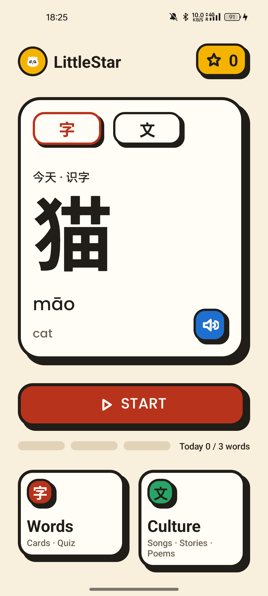

# LittleStar · 汉字积木

一个给海外华裔孩子（3–6 岁）离线学汉字与中文文化的 Android 应用。界面外壳英文、教学内容中文，家长区 PIN 保护。

> Java 17 · XML View + ViewBinding · 无 Kotlin · 无数据库 · 无网络权限



## 功能

| 模块 | 内容 |
|---|---|
| 字 | 6 主题 × 6 字（动物/水果/颜色/数字/家人/自然），识字卡 → 四选一测验 → 星星奖励 |
| 文 | 儿歌 / 故事 / 古诗共 11 条，后台播放、锁屏控制、歌词高亮、睡前定时 |
| 家长区 | PIN 验证、学习概览、时长上限与休息提醒、学习计划与每日提醒、学习记录 |
| 系统 | 每日时长限制、休息页、每日提醒通知、深色模式、进度进程恢复 |

## 技术要点

- **数据**：不用数据库。学习进度存 `progress.json`（`AtomicFile` 原子写 + 2 秒防抖 + 每日备份 + 损坏回退）。
- **线程**：磁盘单线程 `AppExecutors.diskIO()`，状态只在该线程读改，天然免锁。
- **架构**：Activity/ViewBinding → ViewModel(LiveData) → Repository → 纯 Java `domain/`（可 JVM 单测）。
- **设计系统**：自绘 `BlockLayout` 硬影块（按下内容下沉、影子剩 2dp），颜色/尺寸/文案全部资源化。
- **字音**：打包汉字子集字体（43KB）保证不同厂商字形一致；字音为预录音频。

## 构建

```bash
# 需要 JDK 17、Android SDK（compileSdk 36）
echo "sdk.dir=$HOME/Library/Android/sdk" > local.properties
./gradlew assembleDebug          # 产物 app/build/outputs/apk/debug/
./gradlew testDebugUnitTest      # JVM 单测（46 个）
./gradlew connectedDebugAndroidTest   # 真机 Espresso（需连接设备）
```

## 工程校验

```bash
python3 tools/contrast_check.py    # WCAG 对比度（浅色 + 深色，全部 ≥ 4.5）
python3 tools/validate_content.py  # 内容 JSON ↔ 音频/图片资源一一对应
python3 tools/subset_font.py       # 重新生成汉字子集字体（需 fonttools）
bash tools/make_placeholder_audio.sh  # 开发期占位音频（macOS say）
```

## 文档

- [设计书 v3](LittleStar_设计书_v3.md) · [工程设计文档](LittleStar_工程技术文档.md)
- [验收清单](docs/ACCEPTANCE.md)
- [开发决策记录](docs/DECISIONS.md)
- 逐里程碑截图：[M1 组件](docs/screenshots/M1) · [M3 学习流](docs/screenshots/M3) · [M4 字](docs/screenshots/M4) · [M5 文化](docs/screenshots/M5) · [M6 家长](docs/screenshots/M6) · [M7 时长](docs/screenshots/M7) · [M8 走查](docs/screenshots/M8)

## 已知限制

- 插画与音频是占位（`ill_placeholder` 色块 + macOS TTS），正式版需换真人录音与定稿插画。
- 1.3 倍字体 / 360×640 小屏未做真机走查（测试机 ROM 限制，组件级已由 Gallery 覆盖）。
- 每日提醒的重启重排仅代码审查通过，未做真机重启验证。
- PIN 明文存 SharedPreferences（定位为儿童锁，非安全边界）。

## 内容版权

儿歌/古诗文本与故事改写文本为公版或自写；占位音频由 TTS 生成，仅开发用。字体 Noto Sans SC（SIL OFL 1.1）、Poppins（SIL OFL 1.1）。
