# LittleStar 设计书 v3：汉字积木

> 2026-10-24 更新（D35、D36）：浅色主题采用暖白背景与白色卡片；收藏与睡前定时已删除，普通媒体播放和每日学习提醒保留。下文旧收藏、定时与晚安通知设计仅作历史参考。

> 2026-10-24 更新：[D34](DECISIONS.md#d34--2026-10-24--删除星星奖励) 已移除星星奖励、累计计数及音效，完成页仅展示完成反馈和本轮新字；存档 v1 迁移为 v2，保留学习记录。下文星星相关内容为历史设计。

> 2026-10-24 更新：家长页现仅配置每日识字目标及学习提醒，保留 PIN 验证；休息提醒、每日限时、加时和统计记录界面均已删除。首次引导为目标 → 提醒两步。当前行为以 [D33](DECISIONS.md#d33--2026-10-24--家长页仅配置学习任务) 为准，下文相关家长多屏和时长限制内容为历史设计。

> 面向 3–6 岁、在澳洲学中文的孩子，以及他们的家长。
> 视觉与体验版 · 2026-10-21 · 取代 v2（v2 已归档到 [`archive/`](archive/)）

这一版不是 v2 的修补。v2 是一份好看的风格指南；v3 要回答的是：**孩子每天怎么用、每一屏为什么只有一个动作、每一块颜色为什么在这里、以及团队怎么把它做出来。**

阅读方式：每屏五段——**目的 / 结构 / 交互 / 状态 / 不要**。所有图按 360 × 800dp 画布绘制，3× 导出；源文件在 [`explore/`](explore/)，成品在 [`assets/`](assets/)。

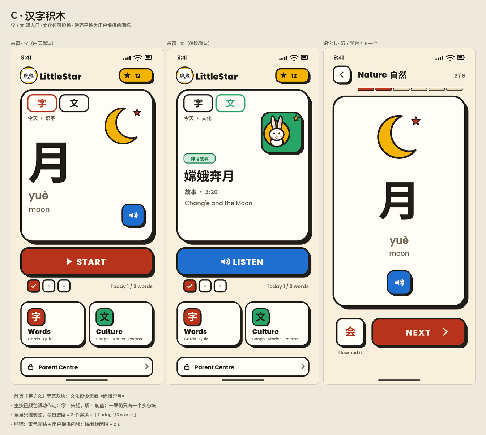

---

## 0. 为什么重做

| v2 的问题 | 具体表现 | v3 的做法 |
|---|---|---|
| 只有风格，没有逻辑 | 首页「今日一词」点进去是主题页；识字卡两个一样大的通栏按钮；星星既是进度又是奖励 | 定义「每日会话」；按钮分四级；星星只做奖励，进度用字块 |
| 页面覆盖不全 | 只详述了 8 屏；家长 4 个子页、收藏、定时只有一句话 | 16 个 Activity 全覆盖，另补空状态、休息页、通知，共 31 张整屏 |
| 不够孩子 | 顶部两行问候 + 英文副标题；米灰成人气质；正文挤 | 24dp 边距；先图后字；孩子区一屏不超过 3 行字；主按钮 64dp |
| 文化只停在色值名字 | 朱红/青绿/宣纸听起来成立，但形、图、动效、奖励没有记忆点；Culture 只有歌 | 「字 / 文」双入口；文 = 儿歌 / 故事 / 古诗 / 成语 / 节日；节日与神话进首页 |
| 落不了地 | 色值、圆角、禁用规则和代码各说各话 | 设计系统 + 组件库 + 资源对照 + 验收表；所有块都能用 XML 画出来 |

---

## 1. 孩子与一天

**乐乐，4 岁，墨尔本。** 家里说中文，幼儿园说英文。她认识几个字，但不会读句子。妈妈希望她上小学前认识一些常用字，但不想她盯着屏幕超过 20 分钟。

| 时间 | 场景 | 界面 |
|---|---|---|
| 07:30 | 出门前，妈妈让她认一个字 | 首页 · 字（默认）→ 3 张识字卡 |
| 17:30 | 放学后，她自己点开听故事 | 首页 · 文（默认）→ 嫦娥奔月 |
| 19:30 | 睡前，妈妈设 20 分钟定时 | 播放器 → 睡前定时 |
| 周末 | 妈妈看这周学了多少 | 家长验证 → 概览 → 记录 |

**每日会话：** 3 个新字 + 2 个复习字 = 5 道测验；3–5 分钟学，2–3 分钟测，1 分钟奖励。星星只在这时发放。

**设计含义：**

- 她不识字，所以**图、声、位置**必须先于文字。
- 她记不住长句，所以**一屏一件事**，主按钮只有一个。
- 她手指不准，所以孩子区点按区 **≥ 56dp**，主按钮 **64dp**。
- 她会误触，所以**答错不惩罚**：陶土色 + 抖动 + 正确答案，不用红色。

---

## 2. 六条原则

1. **一屏一个主角，一个实心块。**
   每屏只有一个 64dp 实心主按钮；其余是 56dp 次按钮、48dp 图标、40dp 文字行。
   *验收：截图上数一数，实心主块是否只有一个。*

2. **字要正，界面才敢玩。**
   教学内容一律用标准黑体（Noto Sans SC / 苹方）。不用快乐体、手写体、艺术字写汉字。
   *验收：把「月」放大到 200%，笔画是否和课本一致。*

3. **颜色有职务。**
   朱红 = 去做 / 汉字；藤黄 = 星星 / 奖励；青绿 = 文化 / 答对；靛蓝 = 听 / 媒体；陶土 = 答错。中性色占 80%。
   *验收：遮住文字，只看颜色，能不能猜出这块是干什么的。*

4. **硬反馈。**
   4dp 墨线 + 6dp 硬影，无模糊、无渐变；按下沉 3dp，影子变短；动作都有声音。
   *验收：按下去有没有「咔哒」的物理感。*

5. **先图后字。**
   每个动作都有图标 + 声音 + 固定位置；孩子区正文不超过 3 行，家长区才允许长说明。
   *验收：把文字全部模糊，孩子还能不能完成主流程。*

6. **留白即秩序。**
   页面边距 24dp，区块 24–32dp，卡片内 16–24dp；一屏最多 4 个主操作，家长入口是低权例外。
   *验收：1.3 倍字体下，元素是否还呼吸得开。*

---

## 3. 视觉概念：汉字积木

**把汉字当成积木。** 一块积木有三个特征：硬边、重量、可拼。界面也这样：4dp 墨线是边，6dp 硬影是重量，字 / 文 / 故事 / 古诗是拼法。孩子每学会一个字，就像往自己的小盒子里放了一块积木。

| 要 | 不要 |
|---|---|
| 大色块、粗描边、硬投影 | 渐变、模糊阴影、玻璃拟态 |
| 纸白 + 墨 + 四块有职务的颜色 | 六种主色平均用力 |
| 标准黑体大字 | 用装饰字体写汉字 |
| 星星、印章、玉兔、月亮 | emoji 当界面图标 |
| 一个实心块 | 两个同样大的通栏按钮 |
| 24dp 边距 | 把信息塞满每一寸 |

**为什么汉字不用装饰字体。** 我试过快乐体，确实可爱，但会把「月」写歪。识字 app 的第一职责是让字形正确；童趣应该来自积木、颜色、动效和插画，而不是把字写变形。

**角色。** 熊猫图标由项目提供（用户提供的 SVG）：白脸、大眼斑、粉腮红，统一放在黄色圆贴上，外圈 3–4dp 墨线。月牙、玉兔与词卡配图为本次绘制。字体使用 Noto Sans SC 与 Poppins（均为 OFL）。

---

## 4. 设计系统

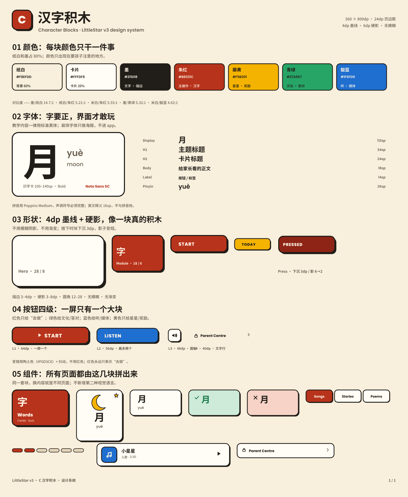

### 4.1 颜色

| 角色 | 浅色 | 用在哪 | 不要用在哪 |
|---|---|---|---|
| 纸白 paper | `#F8EFDD` | 页面背景（约 60%） | 卡片、按钮 |
| 卡片 card | `#FFFDF6` | 卡片、输入框、行（约 20%） | 页面背景 |
| 墨 ink | `#211D18` | 正文、描边、硬影 | 大面积填充 |
| 次要 muted | `#6E6252` | 拼音、说明、时间 | 主标题 |
| 朱红 red | `#B8331C` | 主按钮、字模块、印章 | 答错、装饰 |
| 藤黄 yellow | `#F5B301` | 星星、奖励、Today 标签 | 按钮大面积（4 个以上） |
| 青绿 green | `#27A567` | 文模块、答对、开关 | 主按钮 |
| 靛蓝 blue | `#1F6FD0` | 听、媒体、播放器 | 文化分类 |
| 陶土 clay | `#F6D3C6` | 答错容器 | 任何「去做」 |
| 薄荷 mint | `#CDEBD8` | 答对容器 | 页面背景 |

**四块颜色的职务，不随页面变：**

- 红：**去做**。START、完成、保存、Quiz 入口。
- 黄：**奖励**。星星、Today 标签、选中态高亮。
- 绿：**文化 / 答对**。文模块、答对选项、开关。
- 蓝：**听 / 媒体**。小喇叭、播放器、歌词高亮。

**对比度（实测）：**

| 组合 | 比值 | 结论 |
|---|---|---|
| 墨 / 纸白 | 14.7 : 1 | AA |
| 次要 / 纸白 | 5.2 : 1 | AA |
| 纸白 / 朱红 | 5.21 : 1 | AA |
| 米白 / 朱红 | 5.55 : 1 | AA |
| 卡片 / 朱红 | 5.85 : 1 | AA |
| 墨 / 藤黄 | 9.0 : 1 | AAA |
| 墨 / 青绿 | 5.3 : 1 | AA |
| 米白 / 靛蓝 | 4.62 : 1 | AA |
| 墨 / 陶土 | 12.1 : 1 | AAA |

按钮文字用米白 `#FFF6E7`；纸白 `#F8EFDD` 也过 AA。绿色实底上的小字必须用墨色（5.32）；cream on green 只有 2.94，只能用于大号字形或图标。

**深色模式**（`values-night`，上线前用同一脚本复算 ≥ 4.5）：

| 角色 | 深色 |
|---|---|
| 背景 | `#17130E` |
| 卡片 | `#241F19` |
| 文字 | `#F3E7D3` |
| 次要文字 | `#C9B79B` |
| 朱红 | `#FF8A6E` |
| 藤黄 | `#FFC94D` |
| 青绿 | `#6FD3A2` |
| 靛蓝 | `#7FB4FF` |
| 陶土 / 薄荷 | `#4A2A24` / `#1E4A3A` |
| on-color（所有实色块） | `#17130E` |
| 硬影 | `#000000` |

深色不是把浅色反相：纸白变墨，墨变米白，四块颜色提亮一档；**每个实色块配 on-color `#17130E`**（实测朱红 8.0、靛蓝 8.7）；**硬影用纯黑，不跟文字色**；描边用 `#F3E7D3` 的 70%。

### 4.2 字体

| 用途 | 字体 | 字号 / 行高 | 字重 |
|---|---|---|---|
| 识字卡大字 | Noto Sans SC | 100–140 / 1.0 | 700 |
| 首页今日字 | Noto Sans SC | 108 / 1.0 | 700 |
| 页面大标题 | Noto Sans SC | 26–32 / 1.2 | 700 |
| 卡片标题 / 模块名 | Noto Sans SC | 22–24 / 1.25 | 700 |
| 行标题、家长区 | Noto Sans SC | 14–18 / 1.4 | 600 |
| 正文（家长区） | Noto Sans SC | 14–16 / 1.6 | 500 |
| 拼音 | Poppins | 10–25 / 1.3 | 500–600 |
| 英文释义 | Poppins | 10–17 / 1.4 | 500 |
| 按钮 / 数字 | Poppins | 16–28 | 800 |

**规则：**

- 视觉稿用 **Noto Sans CJK SC** 渲染（与 Noto Sans SC 同源，字宽一致）；Android 用 Noto Sans SC / CJK。不再用苹方替代，否则 312 / 498 这些精确尺寸会对不上。
- 汉字最小 40sp（识字卡 100–140）；孩子区正文最小 11，家长区 14。
- 拼音声调符号必须完整；英文释义比拼音小一档，不与拼音抢。
- 标题单行，放不下就缩字号或删字，不换行。
- 不用 `textSize` 散落写死；用 `TextAppearance` 统一。

### 4.3 形状与硬影

| 元素 | 圆角 | 描边 | 硬影 |
|---|---|---|---|
| 主角卡（今日字 / 识字卡） | 28 | 4dp | 8dp |
| 模块 / 分类块 | 18 | 3–4dp | 5–6dp |
| 按钮（主 / 次） | 18 | 3–4dp | 5–6dp |
| 词块 / 列表行 | 16–18 | 3dp | 3–4dp |
| 标签 / 胶囊 | 8–12 | 2–3dp | 2–3dp |
| 输入框 | 14 | 3dp | 0–3dp |

**按下：** 块向右下移 3dp，影子从 6dp 缩到 2dp，100ms；松开回弹 180ms。无模糊、无渐变。

### 4.4 间距与点按

- 8dp 网格；页面边距 **24dp**；区块 **24–32dp**；卡片内 **16–24dp**；元素间 **8–12dp**。
- 孩子区：主按钮 **64dp**，次按钮 **56dp**，图标 **48dp**，最小点按 **48dp**。
- 家长区：行高 **56dp**，按钮 **56dp**，文字 **14–16sp**，可以更密。

### 4.5 图标

- 统一 24 网格、2.8dp 描边、圆头圆角；跟文字同色。
- 现有：back / chevron / play / pause / prev / next / speaker / star / check / close / lock / heart / moon / clock / calendar / history / quiz / music / book / scroll。
- **emoji 不进界面**。emoji 只能当学习内容配图，且必须包在色块里。

### 4.6 熊猫盼盼 v3

| 醒着 | 睡着 |
|---|---|
|  |  |

- 白脸、大眼斑、粉腮红（用户提供的熊猫 SVG）；统一放在黄色圆贴上，外圈 3–4dp 墨线。
- 40dp 看头像，100dp 看奖励；睡眠版去掉眼球、在眼斑上画奶白闭眼弧线 + z z，用于收藏空态、睡前定时和休息页。
- 始终站在黄色块/圆上，保证白脸在米白底上也看得清。
- 词卡配图：月牙、山、水、火、木、星，3dp 描边、2–3 色、64dp 盒。

### 4.7 动效与声音

| 动作 | 时长 | 效果 | 声音 |
|---|---|---|---|
| 按下 | 100ms | 下沉 3dp，影子变短 | 木块「嗒」 |
| 翻卡 | 240ms | 左滑 + 轻微旋转 2° | 纸张「唰」 |
| 答对 | 300ms | 选项变薄荷 + 打勾 | 两音上行 |
| 答错 | 200ms | 抖动 ±4dp，陶土色 | 柔和「噗」 |
| 得星 | 400ms | 星星 0.6 → 1.15 → 1 | 亮片「叮」 |
| 页面切换 | 260ms | 右进右出 | 无 |
| 家长区 | 180ms | 淡入 | 无 |

声音是学习的一部分：每个字、每个选项、每个反馈都有声音。系统「减少动态效果」开启时，用淡入替代位移。

---

## 5. 组件库

| 组件 | 尺寸 | 用途 | 关键规格 |
|---|---|---|---|
| 主块 Primary | 64dp 高 | 一屏一个主操作 | 红/蓝填充、4dp 墨线、6dp 硬影 |
| 次块 Secondary | 56dp 高 | 听、再玩一次 | 黄填充或描边 |
| 图标块 Icon | 48dp | 返回、收藏、播放 | 3dp 描边 |
| 文字行 Text row | 40–48dp | 家长入口、Sleep timer | 无填充、3dp 描边 |
| 主角卡 Hero | 312 × 360–500 | 今日字 / 识字卡 | 28 圆角、4dp 线、8dp 影 |
| 模块块 Module | 150 × 104 | 字 / 文 | 实色、4dp 线、6dp 影 |
| 词块 Word tile | 150 × 160 | 词表 | 图 64、字 40、拼音 13 |
| 测验选项 Option | 150 × 92 | 四选一 | 16 圆角、3dp 线、4dp 影 |
| 分类块 Category | 150 × 128 | 五类文化 | 图标 40、标题 22、计数 10 |
| 列表行 Row | 312 × 80 | 文化列表 | 封面 56、标题 18、播放 40 |
| 家长行 Parent row | 312 × 56 | 三个子页 | 图标 40、标题 14、副 11 |
| 进度块 Progress | 32 × 8 | 词表 / 测验 | 6 段或 5 段 |
| 开关 Switch | 52 × 30 | 设置 | 关灰、开绿、白钮 |
| 步进器 Stepper | 52 × 52 | 每日字数 | − / 数字 / + |
| 输入框 Input | 312 × 56 | 家长验证 | 红描边、光标 |
| 空状态 Empty | 312 × 260 | 收藏 / 记录 | 睡熊猫 + 一句 + 一个主块 |

---

## 6. 信息架构与流程

```
首页
├─ 字 Words
│  ├─ 主题选择（6 个）
│  ├─ 词表（6 个字）
│  ├─ 识字卡（左右滑 / 听 / 学会）
│  ├─ 测验（5 题）
│  └─ 奖励（3 星 / 再玩一次 / 回首页）
├─ 文 Culture
│  ├─ 五类：儿歌 / 故事 / 古诗 / 成语 / 节日
│  ├─ 列表
│  ├─ 播放器（进度 / 歌词 / 收藏 / 定时）
│  └─ 收藏 / 睡前定时
└─ 家长
   └─ 验证 → 概览 → 时长 / 计划 / 记录
```

**16 个 Activity 与屏的对应：**

| Activity | 屏 |
|---|---|
| MainActivity | 首页（字 / 文） |
| A1 CategoryActivity | 主题选择 |
| A2 CardListActivity | 词表 |
| A3 FlashCardActivity | 识字卡 |
| A4 QuizActivity | 测验 |
| A5 RewardActivity | 奖励 |
| B1 MediaCategoryActivity | 文化分类 |
| B2 MediaListActivity | 文化列表 |
| B3 PlayerActivity | 播放器 |
| B4 FavouritesActivity | 收藏 |
| B5 SleepTimerActivity | 睡前定时（BottomSheet） |
| C1 ParentGateActivity | 家长验证 |
| C2 DashboardActivity | 概览 |
| C3 TimeLimitActivity | 使用时长 |
| C4 LearningPlanActivity | 学习计划 |
| C5 LearningRecordActivity | 学习记录 |

REST / LIMIT 是覆盖在首页上的状态，不单独占 Activity。

**每日会话：** 首页 START → 3 张识字卡（新字）→ 5 道测验（3 新 + 2 复习）→ 奖励 → 回首页。全程 5–10 分钟。

**首页「字 / 文」规则：**

- 06:00–16:59 默认识字；17:00–21:59 默认文化；22:00–05:59 默认文化，只推睡前故事 / 古诗。
- 手动点另一块，立即切换，只在本次打开有效；下次启动回到时间规则。
- 切换只改主角卡，不离开首页；模块才进入列表。两者不是同一件事。

**每日目标 N（1–10）：** 首页显示 k/N；N ≤ 5 用字块，N > 5 用进度条；一轮新字 = min(3, N−k)，复习补满 5 题；目标完成后 START 变「复习一下」。

**文化分类：** 儿歌 / 故事 / 古诗 / 成语 / 节日。故事里含神话、寓言、成语故事；节日含春节、中秋、端午。

**家长流程：** 算术验证 → 概览（今日时长 / 识字 / 测验正确率 + 本周柱状图）→ 时长 / 计划 / 记录。家长区无熊猫、无星星；用 2dp 线 + 2dp 影，比孩子区轻一档。

**通知：**

| 通知 | 触发 | 点击 |
|---|---|---|
| 每日学习提醒 | 到达家长设定时间 | 打开首页 |
| 休息提醒 | 到达每日时长 | 打开休息页 |
| 睡前故事结束 | 定时器到时 | 打开首页 |

三个通知使用不同 ID，不互相覆盖；长文用可展开样式。

---

## 7. 逐屏设计

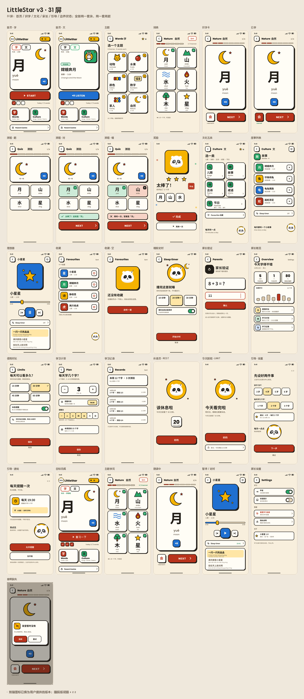

### 7.1 首页 · 字 / 文

| 字（白天默认） | 文（傍晚默认） |
|---|---|
| 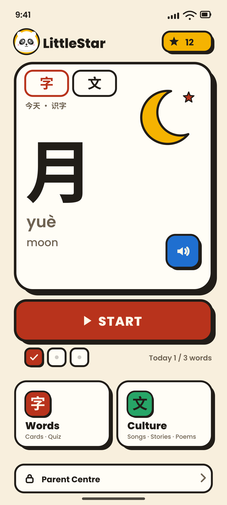 | 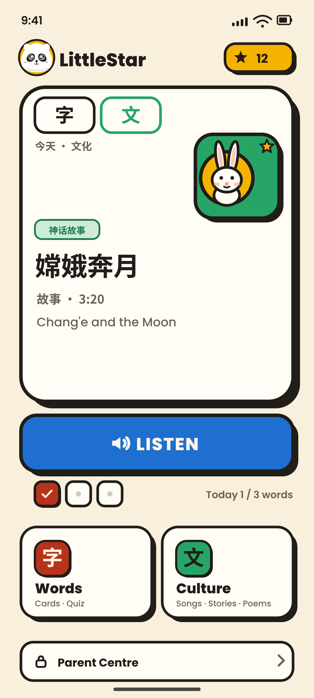 |

**目的：** 每天只推一件事；孩子一打开就知道「现在该做什么」，家长一眼能看到今天的量。

**结构：**

- 顶栏：36dp 熊猫头像 + LittleStar + 星星胶囊（累计奖励，不是进度）。
- 主角卡 312 × 360：顶部「字 / 文」等宽**描边**双块（不是实心块）；下方一句「今天 · 识字 / 文化」；主体是今日字或今日故事；一个蓝色「听」块。
- 主按钮 64dp：字态 START（红），文态 LISTEN（蓝）。
- 今日进度：3 个字块 +「Today 1/3 words」，第一个打勾。
- 模块：字 / 文，150 × 104，卡片底 + 彩色字形块 + 墨线；只有 START 是实心红。

**实心规则：** 首页只有一个实心红块（START）；切换和模块都是描边。切换只改主角卡，模块才进入列表。
- 家长入口：312 × 44，低权描边行，距模块 **28dp**。

**交互：**

- 点「字 / 文」切换；默认按时间，手动只在本次有效。
- 点主角卡或蓝色「听」块，重复朗读。
- START 进入今日 3 字会话；LISTEN 进入播放器。
- 星星胶囊只显示累计奖励，点按不进入任何页面（避免孩子误触）。

**状态：** 字 / 文两种；今日 0/3、1/3、2/3、3/3；星星数变化。

**不要：** 两个实心按钮；用星星表示进度；顶部两行问候；把 Culture 藏进二级页。

### 7.2 主题选择

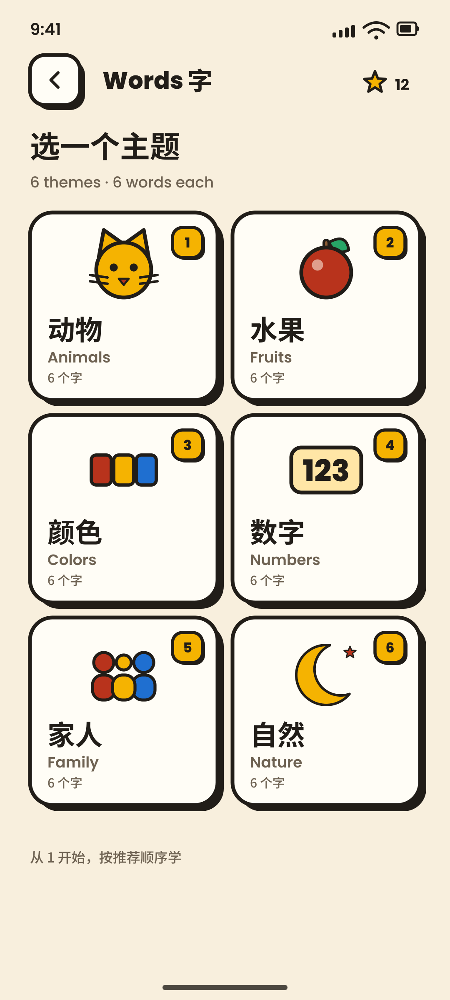

**目的：** 让孩子选一个他感兴趣的世界；让家长看到推荐顺序。

**结构：** 6 个 150 × 150 主题块，2 列 × 3 行；每块 = 64dp 主题插画 + 序号徽章 + 中文名 22 + 英文 12 +「6 个字」10；底部一句「从 1 开始，按推荐顺序学」。六个主题各一个小插画（猫 / 苹果 / 色块 / 123 / 一家人 / 月亮），不再用文字块；插画的颜色属于内容，不参与颜色角色。

**交互：** 点整块进入词表；序号 1–6 是推荐顺序，不是步骤锁。

**状态：** 学过 / 没学过（可加小绿点）；当前主题高亮。

**范围：** 课程最低 5 个主题；Nature 是第 6 个，用来承载首页的「月」。时间紧可先做 5 个，Nature 作为扩展。

**不要：** 「Step 1」胶囊；三列；每块一种大底色。

### 7.3 词表

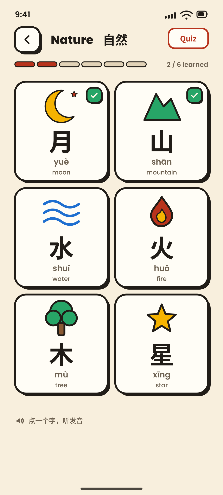

**目的：** 一屏看到 6 个字，知道哪些学过，随时进测验。

**结构：** 顶栏 + 红色描边 Quiz 入口；6 段进度 +「2/6 learned」；2 × 3 词块 150 × 160；每块 = 64dp 配图 + 40sp 汉字 + 13 拼音 + 10 英文 + 学会绿勾；底部「点一个字，听发音」。

**交互：** 点词块进入识字卡并自动朗读；点 Quiz 进测验；点返回回主题。

**状态：** 已学 / 未学；进度段数变化。「星」块里的星星是「星」字的配图，不是奖励图标。

**不要：** 整行「开始测验」大按钮；每块不同颜色；把拼音和英文挤在同一行。

### 7.4 识字卡

| 未学 | 已学 |
|---|---|
|  | 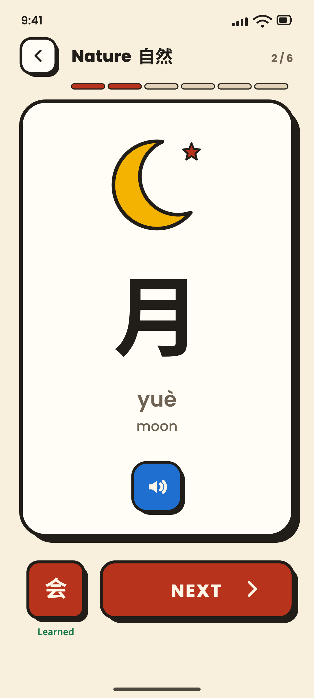 |

**目的：** 一次只看一个字；听、看、认，然后决定「学会了」或「下一个」。

**结构：** 顶栏（返回 / Nature 自然 / 2/6）+ 6 段进度；主角卡 312 × 498：月牙 100、汉字 100、拼音 24、英文 16、蓝色「听」56；底部左侧 64dp 方印（未学：白底 + 朱红「会」；已学：朱红底 + 米白「会」+「Learned」）；右侧 NEXT 220 × 64。

**交互：** 点卡片或蓝色「听」重读；左右滑切换；点印章标记已学（变红、列表出现绿勾）；点 NEXT 下一个字。

**状态：** 未学 / 已学；第一张 / 最后一张（NEXT 文案变「完成」）；朗读中（声波动画）。

**不要：** 两个一样大的通栏按钮；把「我学会了」做成主按钮；把「Swipe」写成一句英文长句。

### 7.5 测验

| 题目 | 答对 | 答错 |
|---|---|---|
| 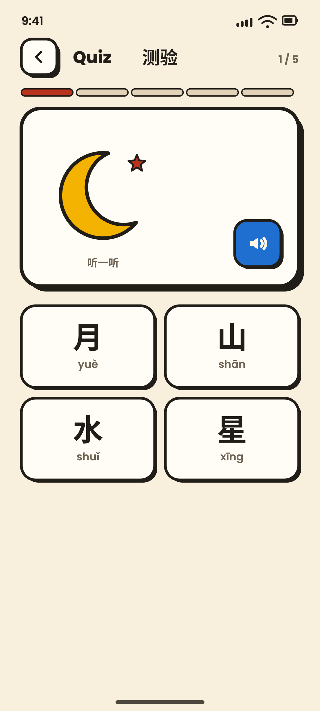 | 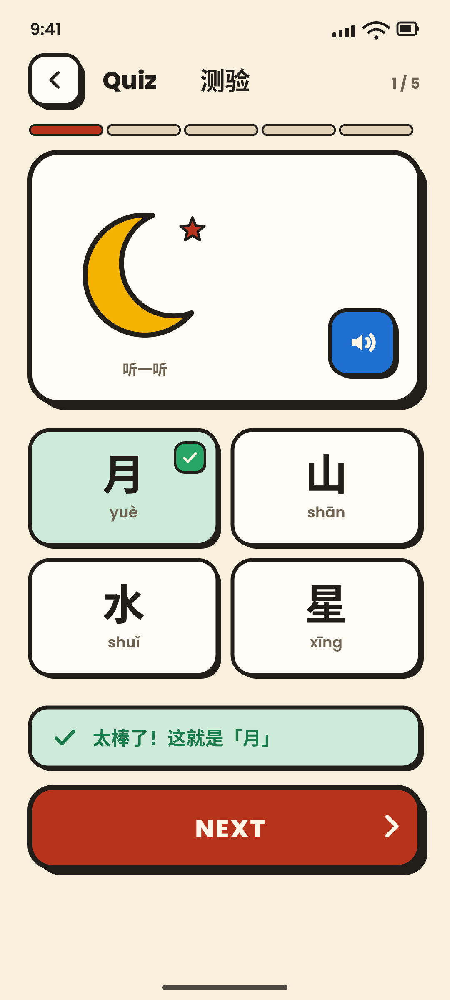 | 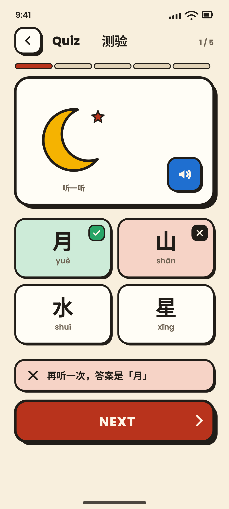 |

**目的：** 用看图选字确认「音—形—义」连上了；答错不惩罚，只再听一次。

**结构：** 顶栏（Quiz 测验 / 1/5）+ 5 段进度；题目卡 312 × 200：月牙 96 +「听一听」12 + 蓝色「听」52；英文默认隐藏，家长在设置打开「双语提示」才显示；四个选项 150 × 92（汉字 34 + 拼音 12）；答题前不显示 NEXT；答后在底部出现 48dp 反馈条 + 64dp NEXT。

**交互：** 进入自动读题；点蓝色「听」重听；点选项立即判定；答对变薄荷 + 勾；答错变陶土 + 墨色 ×，同时正确答案变薄荷 + 勾；反馈默认中文，不夹英文；点 NEXT 进入下一题。

**状态：** 题目 / 答对 / 答错；第 1–5 题；最后一题 NEXT 变「完成」。

**不要：** 红色表示答错；倒计时；答错直接跳过；6 个选项。

### 7.6 奖励

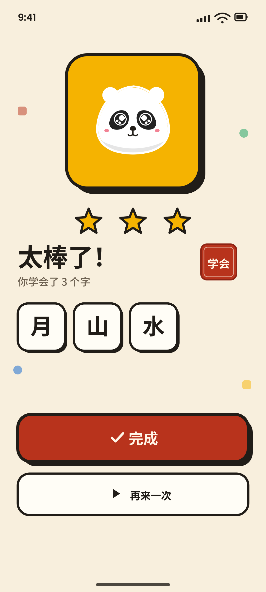

**目的：** 把「我学会了」变成看得见的仪式；告诉孩子今天具体学会了哪几个字。

**结构：** 黄色 180dp 舞台 + 100dp 盼盼；3 颗星；「太棒了！」34；「你学会了 3 个字」14；三个字块（月 / 山 / 水）；红色「学会」印章；「完成」64dp（回首页）；「再来一次」56dp 描边。

**交互：** 星星逐颗弹出（400ms）；点「完成」回首页；点「再来一次」重开本轮。

**状态：** 星星数 = 这一轮新字数（1–3），不是固定 3；如果只学 1 个字，奖励页只亮 1 颗。测验得分记在家长记录里，不重复用星星表示。

**不要：** 满屏 confetti；🎉 emoji；两个实心按钮；把奖励做成抽奖。

### 7.7 文化分类

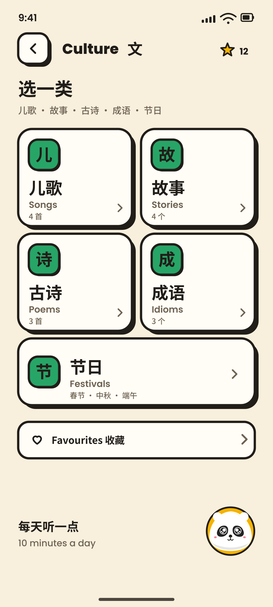

**目的：** 让「文」一眼看出不止音乐；五类内容一屏选完。

**结构：** 顶栏 Culture 文 + 星星数；「选一类」24 + 五类副标题；2 × 2 分类块（儿 / 故 / 诗 / 成）+ 一张 312 × 88 的「节日」宽卡；收藏行 48；底部盼盼 +「每天听一点」。五类统一青绿字形块 + 墨线；分类靠「儿 / 故 / 诗 / 成 / 节」区分，不再用四种色。

**交互：** 点分类进入列表；点收藏进入收藏；节日卡进入节日列表。

**状态：** 五类；每类数量；新增分类时的空态。

**范围：** 课程最低 3 类（儿歌 / 故事 / 古诗）；成语与节日是增强项。时间紧可先做 3 类，首页文化位只在 3 类里轮换。

**不要：** 只有音乐一个入口；用 5 个彩色大卡把屏幕切碎；把成语/节日藏在二级菜单。

### 7.8 文化列表

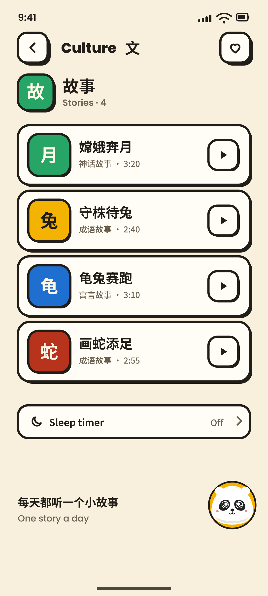

**目的：** 在一个类别里快速选一个故事；顺手能设定睡前定时。

**结构：** 顶栏 Culture 文 + 收藏；类别头（40dp 字形块 + 中文 22 + Stories · 4）；4 行 80dp：56dp 封面 + 标题 18 + 类型/时长 11 + 播放 40；底部 Sleep timer 行；盼盼 + 一句鼓励。

**交互：** 点行进入播放器；点播放直接播；点收藏进收藏；点 Sleep timer 设定时。

**状态：** 4 条 / 空类别；播放中高亮。

**不要：** 顶栏与类别头重复同一个标题；三行文字挤在一行。

### 7.9 播放器


**目的：** 听儿歌/故事时，孩子只需按一个大按钮；家长能看到歌词和定时。

**结构：** 顶栏（小星星 / 收藏）；200dp 蓝色封面 + 星星；标题 28 + 儿歌 · 2:30；10dp 进度条 + 方块拖柄 + 时间；上一首 48 / 播放 76 / 下一首 48；Sleep timer 行；歌词卡 312 × 170，当前句黄色高亮（汉字 18 / 拼音 10 / 英文 10），后两句灰。

**交互：** 播放 / 暂停；上一首 / 下一首；拖进度；点爱心收藏；点 Sleep timer。

**状态：** 播放 / 暂停；收藏 / 未收藏；定时开 / 关；最后一句。

**不要：** 细如发丝的 SeekBar；三个同样大的控制键；歌词三行都加粗。

### 7.10 收藏

| 有内容 | 空状态 |
|---|---|
| 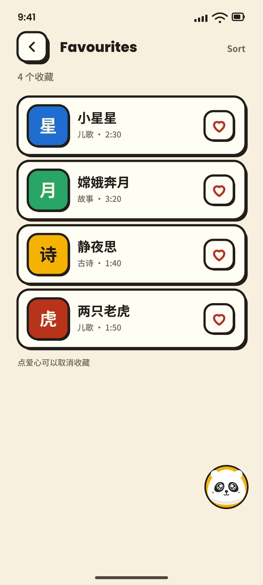 | 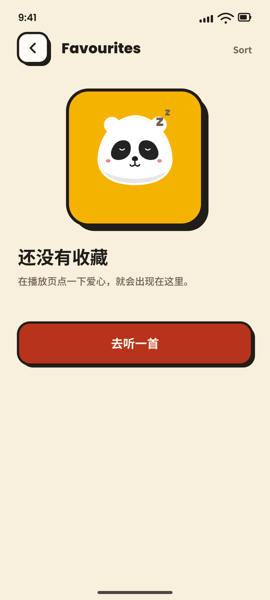 |

**目的：** 把喜欢的故事/儿歌留在手边；空的时候也要好看、有出口。

**结构：** 有内容：4 行 80dp，封面 + 标题 + 类型/时长 + 红心；Sort 入口；「4 个收藏」。空状态：黄色舞台 + 睡熊猫 +「还没有收藏」+ 一句说明 + 红色「去听一首」。

**交互：** 点行播放；点红心取消收藏；Sort 切换最新/最早；空状态按钮回文化分类。

**状态：** 有内容 / 空；1–4 条；排序。

**不要：** 空状态只写「暂无数据」；用灰色线条人；把收藏做成设置项。

### 7.11 睡前定时

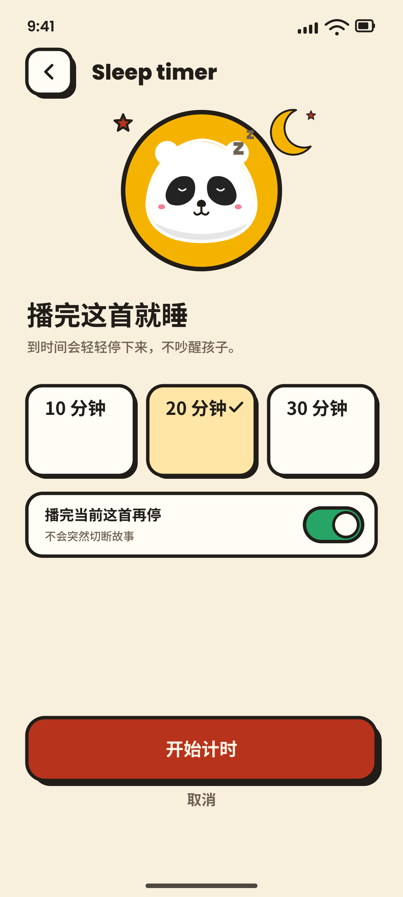

**目的：** 让家长在睡前设一个温柔的停止点，不突然切断故事。

**结构：** 睡熊猫 + 月亮；「播完这首就睡」24；三个 96 × 80 选项（10 / 20 / 30 分钟），选中 20；56dp 开关行「播完当前这首再停」；64dp「开始计时」；文字「取消」。

**交互：** 选时长；开关；开始计时；取消返回。到时先播完当前音轨，再停并通知。

**状态：** 未设置 / 已设置（显示剩余时间）；开关开 / 关。

**不要：** 用系统 TimePicker 让家长算时间；倒计时数字打扰孩子；突然静音。

### 7.12 家长验证

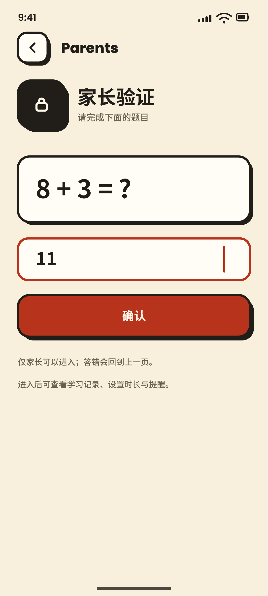

**目的：** 挡住孩子，不挡住家长；让家长知道这是「家长的房间」。

**结构：** 顶栏 Parents；64dp 墨色锁块 +「家长验证」26 + 说明 12；算术卡 312 × 88「8 + 3 = ?」34；输入框 56（红描边 + 光标）；确认 56；两句说明。

**交互：** 输入答案；点确认；答对进入概览；答错抖动 + 清空，不锁定。

**状态：** 空 / 输入中 / 答错；键盘弹起时按钮不被遮。

**不要：** 用登录/密码；用和儿童区一样的熊猫和星星；答错就锁死。

### 7.13 学习概览

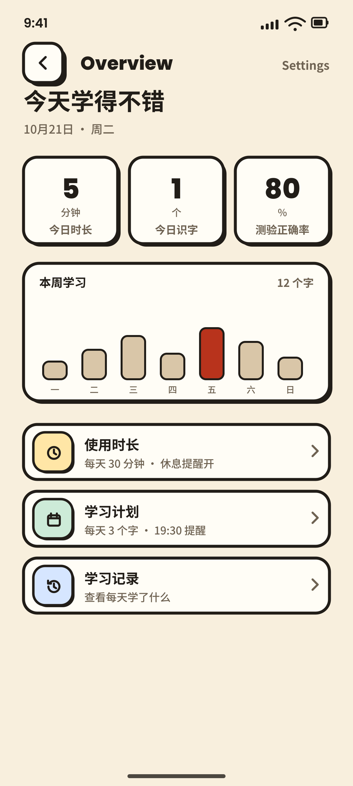

**目的：** 家长 10 秒内知道「今天怎么样、这周怎么样、下一步去哪」。

**结构：** 顶栏 Overview（右上 Settings）；「今天学得不错」24 + 日期 12；三张统计块（5 分钟 / 1 个 / 80%）；本周柱状图（7 根，今天红）；三行入口（使用时长 / 学习计划 / 学习记录）。第三张是**测验正确率**，家长区不显示星星。

**交互：** 点三行进入子页；柱状图点按显示当天数字（可选）。

**状态：** 今天有数据 / 没数据；本周 0；不同时长。

**不要：** 把家长区做成儿童区（大熊猫、星星雨）；一屏放 10 个数字；用红色表示「超时」。

### 7.14 使用时长

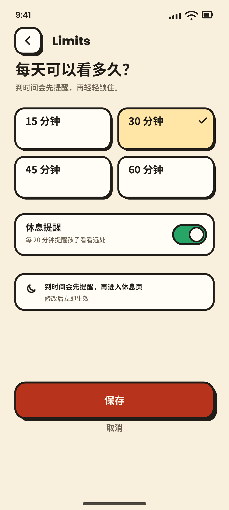

**目的：** 让家长用两次点按设定每日上限和休息提醒。

**结构：** 顶栏 Limits；「每天可以看多久？」24；四个 150 × 64 选项（15 / 30 / 45 / 60），选中 30（黄底 + 墨线 + 勾）；56dp 开关行「休息提醒」；说明卡；保存 56；取消。

**交互：** 选项即选即改；开关；保存立即生效；取消不保存。

**状态：** 选中项；开关；保存成功提示（Snackbar）。

**不要：** 用滑块选分钟；把「保存」做成小文字；允许 0 分钟。

### 7.15 学习计划

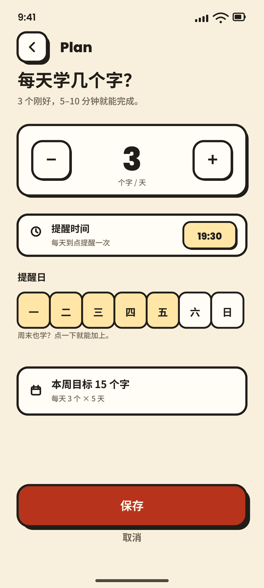

**目的：** 设定「每天几个字、几点提醒、哪几天」，让首页的今日进度有依据。

**结构：** 顶栏 Plan；「每天学几个字？」24；步进器（− / 3 / +）96 高；提醒时间行 56（19:30 黄色块）；7 个 44 × 48dp 星期块，间距 0（一–五选中，黄底 + 墨线）；本周目标卡「15 个字」；保存 / 取消。

**交互：** 步进 1–10；点时间打开 MaterialTimePicker；点星期切换；保存后首页目标和通知时间立即更新。

**状态：** 保存成功；未选任何星期（提示至少选一天）。

**不要：** 用 SeekBar 选字数；把提醒日做成 7 个 CheckBox；保存后不更新首页。

### 7.16 学习记录

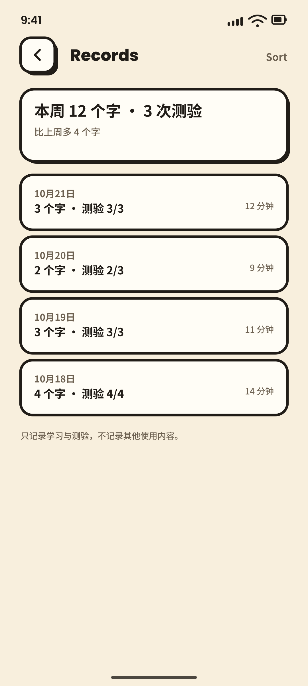

**目的：** 让家长看到「学了什么、测了多少」，而不是只有总时长。

**结构：** 顶栏 Records + Sort；汇总卡「本周 12 个字 · 3 次测验」+「比上周多 4 个字」；4 行 64dp：日期 / 学了几个字 / 测验得分 / 时长；底部隐私说明。

**交互：** 点行看当天详情（可选）；Sort 切换最新/最早；空状态显示睡熊猫 +「还没有记录」。

**状态：** 有记录 / 空；升序 / 降序；本周汇总。

**不要：** 只显示「学习时长」；用图表替代可读的文字记录；记录与学习无关的行为。

### 7.17 休息页：REST / LIMIT

| REST · 休息一下 | LIMIT · 今天到啦 |
|---|---|
| 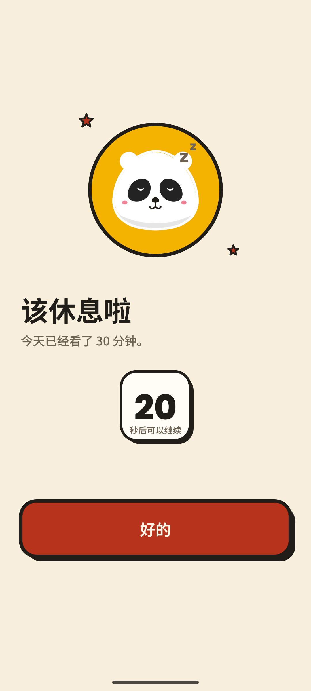 | 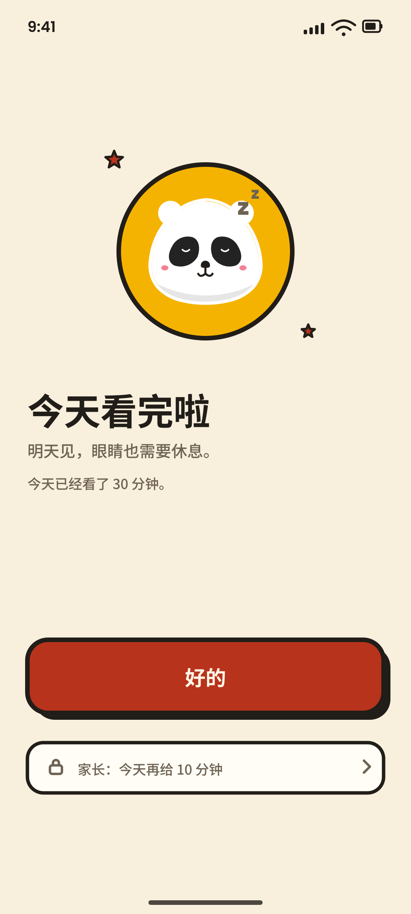 |

**目的：** 到时间时温柔地停下来。但「休息一下」和「今天到顶」是两件事，不能都靠一个 20 秒倒计时。

**REST（休息一下）：** 连续使用 15 分钟，且家长开了「休息提醒」。黄色月亮 + 睡熊猫；「该休息啦」32；「今天已经看了 30 分钟」14；80dp 倒计时「20 秒后可以继续」；倒计时期间「好的」不可点；结束回原页面。

**LIMIT（今天到啦）：** 达到每日上限。睡熊猫 +「今天看完啦，明天见」；**没有倒计时**；「好的」退出 app；当天再打开直接回到这一页；底部「家长：今天再给 10 分钟」→ 家长验证 → 时长 +10。

**交互：** REST 倒计时结束回原页；LIMIT 点「好的」退出；家长延长后回首页。

**状态：** REST 倒计时中 / 结束；LIMIT 已锁 / 已延长。

**不要：** 点「好的」就继续玩；用倒计时暗示「等一下还能玩」；红色警告；让孩子无法退出。

### 7.18 通知

| 通知 | 文案 | 点击 |
|---|---|---|
| 每日学习提醒 | 「该学汉字啦：今天还有 2 个字」 | 首页 |
| 休息提醒 | 「眼睛累了吧？休息 5 分钟」 | 休息页 |
| 睡前故事结束 | 「故事讲完啦，晚安」 | 首页 |

- 三个不同 ID；长文用 `BigTextStyle`；小图标用熊猫单色。
- 通知只在家长设定的时间/时长触发；不用于促活营销。

### 7.19 补充状态总览

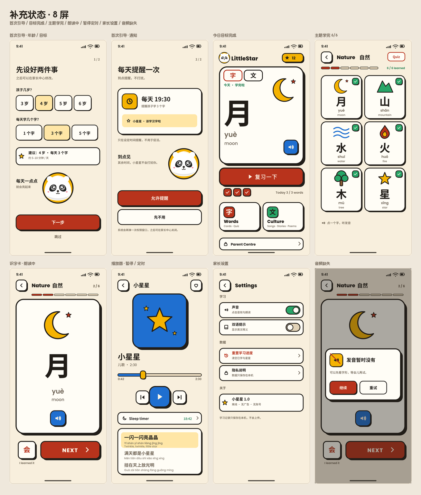

这 8 屏不是新流程，是把已有流程的边界补齐：首次引导、目标完成、主题学完、朗读中、暂停/定时、设置、音频缺失。每屏只加一个状态，不新增导航层级。

### 7.20 首次引导

| 1 / 2 · 年龄与目标 | 2 / 2 · 通知 |
|---|---|
| 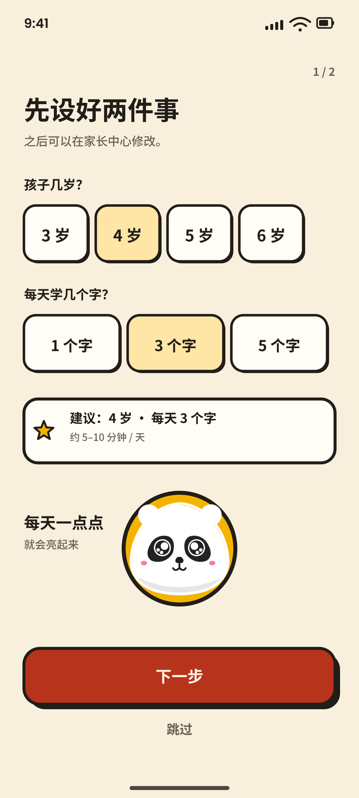 | 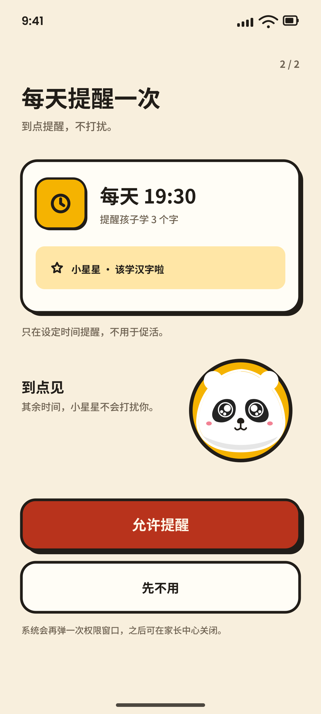 |

**目的：** 第一次打开时，让家长用两次选择把 app 调成适合自己孩子的样子，而不是一上来就要求通知权限。

**结构：** 第一步：年龄 3 / 4 / 5 / 6（默认 4）+ 每天 1 / 3 / 5 个字（默认 3）+ 建议卡 + 下一步。第二步：提醒卡（19:30）+ 允许提醒 / 先不用。

**交互：** 年龄只影响默认目标和建议，不锁内容；允许提醒才触发 Android 13+ 权限弹窗；先不用可稍后在设置打开。

**状态：** 1 / 2、2 / 2；权限允许 / 拒绝 / 稍后。

**不要：** 一上来弹系统权限；把年龄做成内容锁；用 5 个以上选项。

**实现：** 作为 MainActivity 的启动态（firstLaunch），不新增 Activity。

### 7.21 今日目标完成

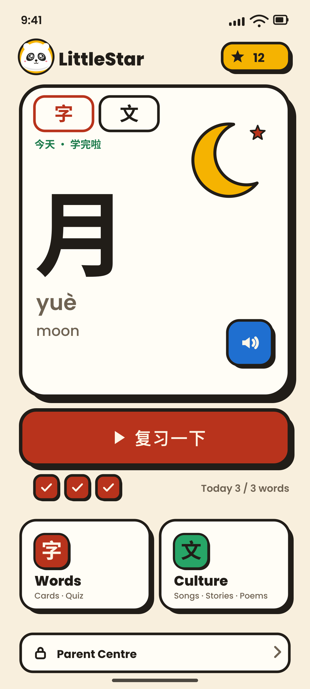

**目的：** 当天 N 个字学完时，首页从「开始」切换到「复习」，不让孩子以为还要继续学新字。

**结构：** 3/3 字块全勾；标签「今天 · 学完啦」变绿；START 变「复习一下」；模块、切换、家长入口不变。

**交互：** 复习一下进入 0 新 + 5 复习的会话；切换字 / 文仍然可用；复习不再新增星星。

**状态：** N = 3 / 5 / 10；N > 5 用进度条；目标完成。

**不要：** 完成后还给新字；把 3/3 写死；复习也给星星。

### 7.22 主题学完

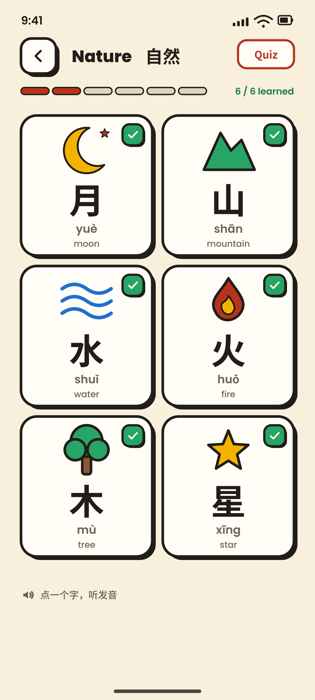

**目的：** 一个主题 6 个字全学完时，给出明确的「这一盒拼完了」的信号，同时保留复习入口。

**结构：** 词表 6/6 全绿勾；进度 6/6；Quiz 仍可进；主题卡可加绿勾徽章（下一版）。

**交互：** 点任一字进入复习；Quiz 重新测；返回主题。

**状态：** 6/6；全勾；无空态。

**不要：** 学完就隐藏列表；只靠颜色表示已学（还有勾和声音）。

### 7.23 朗读中

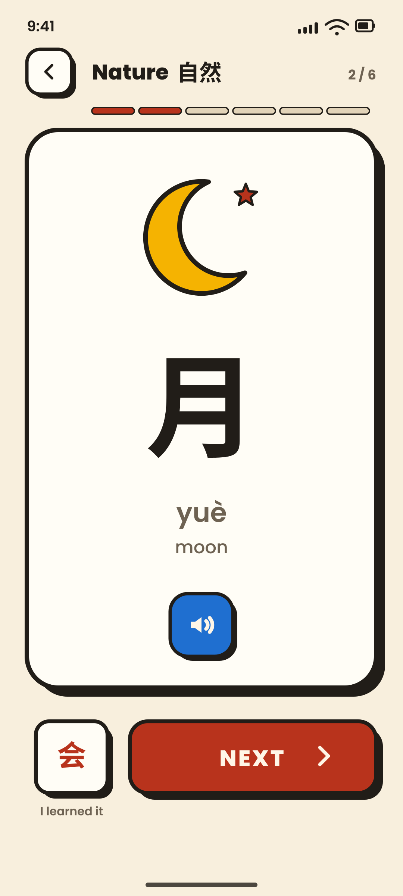

**目的：** 朗读中给一个轻量的「正在出声」反馈，不改变布局。

**结构：** 识字卡同布局；「听」块右侧 5 根蓝色声波条；下方「朗读中」10。

**交互：** 点卡片或「听」重读；声波随音频起伏；读完回到静态；失败走 7.26。

**状态：** 朗读中 / 空闲 / 失败。

**不要：** 转圈；抖动卡片；把声波做成不跟音频的装饰动画。

### 7.24 播放器暂停 / 定时

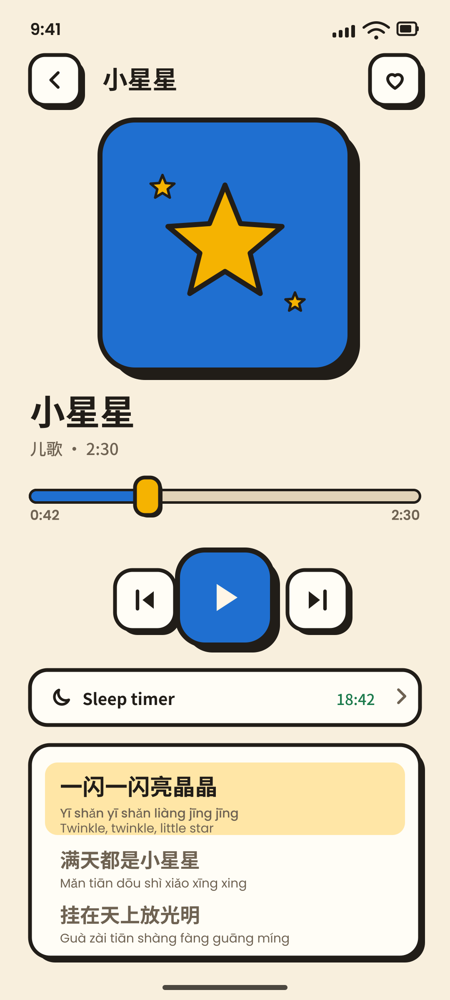

**目的：** 暂停时保留进度和歌词；定时进行中让家长看到剩余时间。

**结构：** 播放键变三角；进度停在 0:42；Sleep timer 显示 18:42（绿色）；歌词保持。

**交互：** 播放恢复；定时继续；点 Sleep timer 改 / 关。

**状态：** 播放 / 暂停；定时关 / 进行中 / 剩余；最后一句。

**不要：** 暂停重置进度；定时用红色；隐藏剩余时间。

### 7.25 家长设置

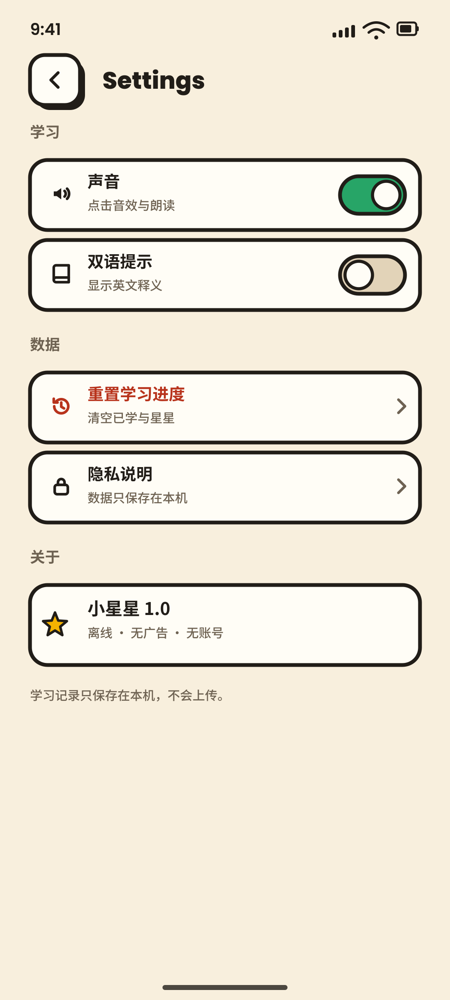

**目的：** 把家长真正会改的设置集中在一页，并把「重置」做成需要确认的动作。

**结构：** 学习（声音、双语提示）；数据（重置进度、隐私说明）；关于（版本、离线 / 无广告 / 无账号）。

**交互：** 开关即时生效；重置弹确认框；隐私说明只读；关于显示版本。

**状态：** 声音开 / 关；提示开 / 关；重置确认。

**不要：** 把设置放孩子区；重置不确认；放广告 / 账号入口。

**实现：** Dashboard 右上 Settings 打开的 BottomSheet，不新增 Activity；重置用 MaterialAlertDialogBuilder 二次确认。

### 7.26 音频缺失

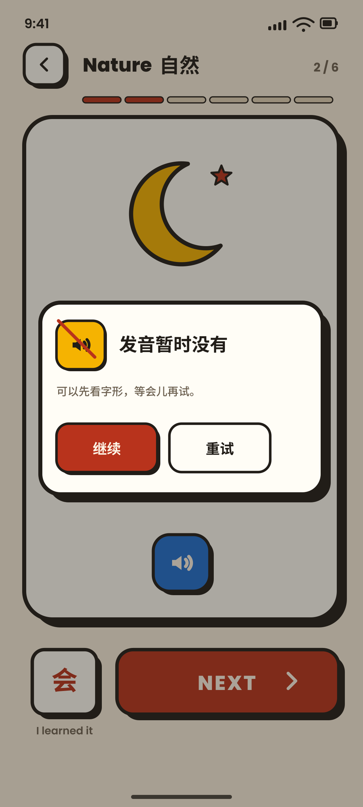

**目的：** 离线 app 也会遇到音频缺失 / 损坏，不能崩，也不能假装没发生。

**结构：** 识字卡上盖一层 38% 墨色遮罩；280 × 190 对话框：喇叭划掉 +「发音暂时没有」+「可以先看字形，等会儿再试」+ 继续 / 重试。

**交互：** 继续关对话框，留在当前字；重试再读；失败只记日志，不阻塞整轮。

**状态：** 缺失 / 损坏 / 重试成功。

**不要：** 崩溃；静默失败；把整轮学习卡死。

**实现：** Flashcard 内的 MaterialAlertDialog，不新增 Activity；`validate_content.py` 在构建前拦截缺音频。

---

## 8. 边界状态

**深色模式。** 所有颜色走角色，不写死；纸白 → 墨、墨 → 米白、四色提亮一档；描边跟随文字色，硬影用纯黑，每个实色块配 on-color `#17130E`；熊猫白脸在深色下仍清楚。验收：每屏截图，文字对比 ≥ 4.5。

**系统栏。** 视觉稿用 Android 状态栏（时间 + 信号 / Wi-Fi / 电池）和底部 4dp 手势条；内容最低 780，底部 24dp 是手势安全区。

**小屏 360 × 640。** 首页和列表可滚动，CTA 以上内容首屏可见；识字卡把卡片压到 408，动作固定在底部；家长表单滚动。640 下主按钮不被手势条遮挡。

| 首页 640（滚动） | 识字卡 640（压缩 + 固定动作） |
|---|---|
| 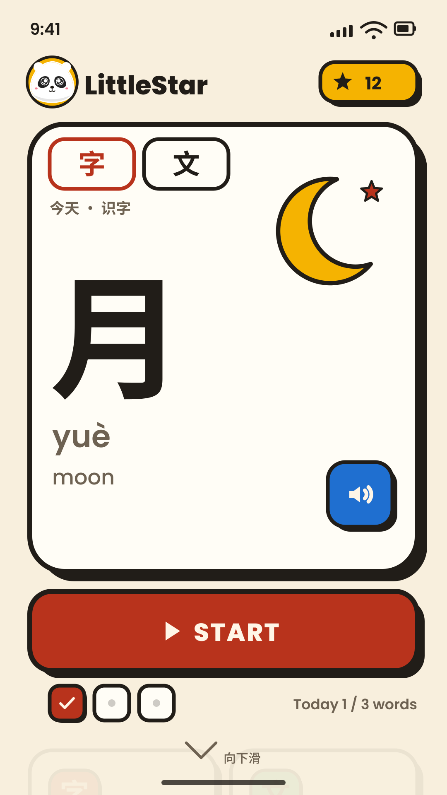 | 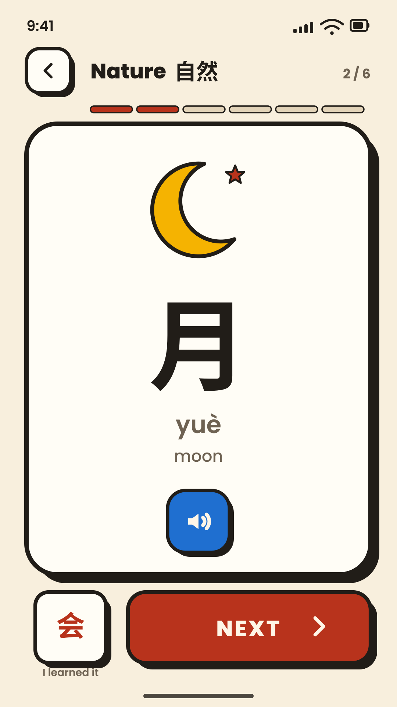 |

**1.3 倍字体。** 标题单行 + 省略；卡片允许纵向长高；按钮文字不换行；识字卡 100sp 在 1.3 倍下仍不被裁切；家长区长说明可换行。验收：系统字体调到最大，逐屏过。

**空状态。** 收藏空、记录空、类别空、今日 0 字：都用睡熊猫 + 一句人话 + 一个出口，不用「暂无数据」。

**离线。** 全部内容内置，无网络请求；音频本地；没有 loading 转圈，最多 200ms 的音频准备。

**无障碍。** 所有图标按钮有 `contentDescription`；装饰图 `importantForAccessibility="no"`；颜色不单独承担意义（答对/答错同时有勾/叉和声音）；点按区 ≥ 48dp。

**家长区。** 无熊猫、无星星、无奖励音效；行高 56、正文 14–16；红色只用于保存/确认。

---

## 9. 交付与验收

### 9.1 文件

```
安卓_v2/
├─ LittleStar_设计书_v3.md        ← 本文
├─ assets/
│  ├─ system/system_overview.png  ← 设计系统总览
│  ├─ screens/                    ← 31 张整屏 + 总览/拼图 + 2 张 640 变体
│  └─ illustrations/              ← 熊猫（已导出）、词卡配图（待导出）
├─ explore/                       ← 生成脚本（可复现）
└─ archive/LittleStar_设计书_v2.md
```

### 9.2 Android 对照

| 设计 | 资源 |
|---|---|
| 颜色角色 | `values/colors_m3.xml` + `values-night/colors_m3.xml` |
| 字体 | `res/font/`：Noto Sans SC + Poppins（OFL） |
| 形状 / 硬影 | `themes.xml` + `shapeAppearance` + `android:elevation=0` + 自定义 shadow drawable |
| 主按钮 | `Widget.LittleStar.BlockButton` 64dp |
| 次按钮 | `Widget.LittleStar.BlockButton.Secondary` 56dp |
| 图标 | `res/drawable/ic_*.xml`，24dp，2.8dp stroke |
| 熊猫 | `res/drawable/ic_panda.xml` + `ic_panda_sleep.xml` |
| 文案 | `strings.xml`（英文 UI + 中文内容） |
| 尺寸 | `dimens.xml`：24 / 16 / 12 / 8 / 64 / 56 / 48 |

### 9.3 验收清单

- [ ] 孩子区每屏只有一个 64dp 实心主块；家长区 56dp。
- [ ] 孩子区点按区 ≥ 56dp，家长区 ≥ 48dp。
- [ ] 汉字全部标准黑体；没有装饰字体写内容。
- [ ] 星星只出现在奖励/累计，不出现在进度条。
- [ ] 答错用陶土色 + 抖动，不用红色。
- [ ] 1.3 倍字体下无裁切、无重叠。
- [ ] 深色模式每屏过一遍。
- [ ] Android 状态栏 + 手势条；640 下主按钮不被遮。
- [ ] 视觉稿和真机都用 Noto，不是苹方。
- [ ] 测验题目卡和反馈默认不显示英文；设置打开双语提示才显示。
- [ ] 所有图标有 contentDescription。
- [ ] 所有音频有本地文件，无网络。
- [ ] 家长验证答错不锁死。
- [ ] REST 倒计时结束回原页；LIMIT 不出现倒计时，重开 app 仍停在 LIMIT。
- [ ] 首页「字 / 文」按时间默认，手动可切。
- [ ] 文化五类都能进列表。
- [ ] 收藏空状态有出口。
- [ ] 记录空状态有出口。
- [ ] 首次引导能选年龄 / 目标，通知权限可拒绝或稍后。
- [ ] 目标完成后 START 变「复习一下」，不再出新字。
- [ ] 主题 6/6 全绿勾，Quiz 仍可进。
- [ ] 朗读中有声波反馈，失败不阻塞。
- [ ] 暂定时保留进度；Sleep timer 显示剩余。
- [ ] 重置进度有确认框。
- [ ] 音频缺失有「继续 / 重试」，不崩。

### 9.4 版权

- 熊猫图标：由项目提供（用户提供的 SVG），仅在本项目内使用。
- 月牙、玉兔、词卡配图：本次绘制。
- 字体：Noto Sans SC、Poppins，均为 SIL Open Font License。
- 图标：自定义描边，参考 Material Symbols Rounded 的语义。

### 9.5 下一步

1. 把 `assets/` 里的 PNG 转成 Android VectorDrawable（熊猫、月牙、玉兔、词卡配图）。
2. 按第 4 章生成 `colors_m3.xml` / `values-night`，跑对比度脚本。
3. 先做「首页 + 识字卡 + 测验 + 奖励」四屏，验证节奏；再做文化五类与家长五屏。
4. 用 1.3 倍字体 + 深浅两套截图做验收，补进本设计书。
